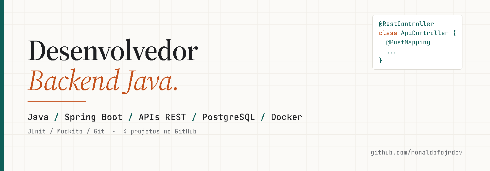

# Olá, eu sou o Ronaldo

Desenvolvedor **Back-End Java júnior**, de São Gonçalo, RJ. Trabalho com **Java e Spring Boot, APIs REST, PostgreSQL, testes com JUnit e Mockito e Docker**.

Tenho mais de 2 anos em uma empresa de software (Green Code), onde fui de estagiário a desenvolvedor full stack, Product Owner e responsável técnico de um produto com mais de 1.000 usuários. Cursando Engenharia de Software (Estácio, conclusão em 2027). Inglês C1.

Portfólio: https://ronaldo-ferreira-dev.vercel.app | LinkedIn: [ronaldo-ferreira-dev](https://www.linkedin.com/in/ronaldo-ferreira-dev/)

## Foco atual

- Java 21 e Spring Boot 3: controllers REST, Spring Data JPA, validação, tratamento de erros e Swagger
- Testes automatizados com JUnit 5 e Mockito
- PostgreSQL, migrações com Flyway e Docker Compose
- Projetos Java pessoais publicados (veja abaixo), evoluídos em commits incrementais

## Experiência em produto real

O código dos projetos de empresas e clientes é privado, então documentei os casos:

- **BoraRachar**, app de divisão de custos (web, Android e iOS): Product Owner e hoje responsável técnico, com API e infraestrutura na AWS ([borarachar.com.br](https://borarachar.com.br))
- **Litso**, sistema de gestão para salões, barbearias e clínicas: [caso documentado](https://github.com/ronaldofojrdev/casos/blob/main/casos/litso-erp.md) ([litso.com.br](https://litso.com.br))
- **ERP e PDV para varejo**, com NFC-e (RJ): [caso documentado](https://github.com/ronaldofojrdev/casos/blob/main/casos/erp-pdv-varejo.md)
- **MWPay**, banco digital: front-end em React
- Automações com IA, web scraping e dashboards em Elasticsearch e Power BI
- [Todos os casos](https://github.com/ronaldofojrdev/casos), com o roteiro de implantação que documentei

## Projetos Java (back-end)

- [carteira-pagamentos](https://github.com/ronaldofojrdev/carteira-pagamentos): carteira digital com idempotência, mensageria e testes
- [billing-assinaturas](https://github.com/ronaldofojrdev/billing-assinaturas): cobrança recorrente e assinaturas
- [estoque-pdv-b2b](https://github.com/ronaldofojrdev/estoque-pdv-b2b): estoque e PDV B2B
- [monitor-saude-servicos](https://github.com/ronaldofojrdev/monitor-saude-servicos): monitoramento de saúde de serviços

Todos em Java e Spring Boot, com PostgreSQL, Docker e testes.

## Outros projetos com código aberto

- [portfolio](https://github.com/ronaldofojrdev/portfolio): o site do meu portfólio
- [atendente-whatsapp-clinicas](https://github.com/ronaldofojrdev/atendente-whatsapp-clinicas): atendente de WhatsApp com IA para clínicas, em Node e TypeScript, multi-clínica
- [freelas-bot](https://github.com/ronaldofojrdev/freelas-bot): bot em Python que avalia projetos do 99Freelas com um modelo local (Ollama)
- [Condofy](https://github.com/ronaldofojrdev/Condofy): gestão de condomínios com Next.js e Supabase (em desenvolvimento)

## Stack

Também uso SQL, Elasticsearch, Power BI, Azure DevOps, Jira e Scrum no dia a dia, e tenho experiência em levantamento de requisitos e implantação de sistemas e ERP.

## Contato

- LinkedIn: [ronaldo-ferreira-dev](https://www.linkedin.com/in/ronaldo-ferreira-dev/)
- E-mail: ronaldofojr1@gmail.com
- Aberto a vagas de desenvolvedor back-end júnior (CLT ou PJ), remoto, híbrido ou presencial no RJ e região
